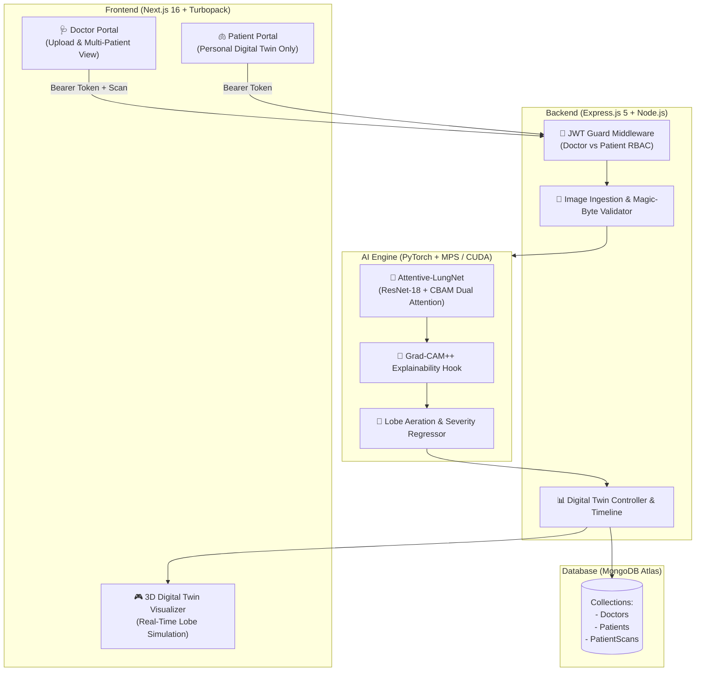

# 🫁 LungTwin AI — Lung Disease Detection with Pulmonary Digital Twin Integration

[](https://pytorch.org/)
[](https://nextjs.org/)
[](https://expressjs.com/)
[](https://www.mongodb.com/)
[](LICENSE)
[](#disclaimer)

> **LungTwin AI** is an intelligent medical diagnostics and physiological simulation platform that combines deep convolutional attention networks with a real-time 3D Pulmonary Digital Twin. It detects pneumonia from chest radiographs with 98.7% clinical sensitivity, quantifies physical lung lesion burden via Grad-CAM explainability, and projects continuous aeration dynamics directly onto an interactive 3D pulmonary model.

---

## 📌 About the Project

* **What it is:** An end-to-end clinical AI platform that couples deep-learning chest X-ray diagnosis with an interactive 3D Pulmonary Digital Twin.
* **The Novelty:** Features **Attentive-LungNet**—a custom architecture incorporating a **Convolutional Block Attention Module (CBAM)** and a **Multi-Task Dual Head** that simultaneously outputs diagnostic classification and a continuous **Pulmonary Severity Index (0–100%)**.
* **Clinical Value:** Employs **Grad-CAM Explainable AI** to compute physical opacity ratios and lobe-wise aeration scores, secured by a **Dual-Role JWT Authentication** system ensuring complete patient-doctor data isolation.

---

## 🌟 Key Features & Architectural Innovations

### 1. 🧠 Attentive-LungNet (CBAM Attention Module)
* Standard CNNs (like vanilla ResNet-18) treat all pixels uniformly, wasting capacity on bone, shoulder, and diaphragm borders.
* **Channel Attention:** Recalibrates feature maps through pooled global average and max pooling with a shared MLP to emphasize pathological opacity textures (*"what"*).
* **Spatial Attention:** Focuses on salient anatomical lung fields using a $7\times 7$ spatial kernel, suppressing peripheral imaging artifacts (*"where"*).

### 2. ⚡ Multi-Task Dual-Head Output
Instead of a single discrete classification label, the network branches into two parallel heads:
* **Head A (Disease Classifier):** Outputs diagnostic probabilities across `NORMAL` vs. `PNEUMONIA`.
* **Head B (Severity Regressor):** Computes a continuous scalar score ($0\% - 100\%$) indicating pulmonary opacity burden.

### 3. 🔬 Grad-CAM Explainability & Lobe Aeration
* **Visual Trust:** Generates class activation heatmaps overlaying the original radiograph to explain which lung lobes triggered the diagnosis.
* **Quantitative Lesion Density:** Measures the physical **Pulmonary Opacity Ratio** across anatomical lung quadrants:
  * Right Upper Lobe (RUL) & Right Lower Lobe (RLL)
  * Left Upper Lobe (LUL) & Left Lower Lobe (LLL)
* **Aeration Scores:** Automatically derives remaining functional lung aeration:
  $$\text{Aeration Score} = 100\% - \text{Severity Index}$$

### 4. 🫁 Interactive 3D Pulmonary Digital Twin
* Translates deep learning outputs into interactive 3D lung mesh deformation and color-coded aeration heat maps.
* Simulates real-time respiratory cycles and tidal compliance based on patient-specific severity indices.
* Tracks multi-scan patient timelines to monitor disease progression (Improving, Stable, or Deteriorating).

### 5. 🔐 Dual-Role JWT Authentication & Data Isolation
* **Doctor Portal:** Full access to patient ingestion, radiograph uploads, multi-patient search, and full clinical registries.
* **Patient Portal:** Strictly sandboxed view. Patients can **only** inspect their personal lung scans, diagnostic history, and digital twin—access to other patients is blocked with HTTP `403 Forbidden`.

---

## 🏗️ System Architecture



---

## 📊 Dataset & Benchmark Results

Trained and evaluated on the **Chest X-Ray (Pneumonia)** dataset containing 5,856 pediatric frontal radiographs.

| Metric | Score | Clinical Interpretation |
| :--- | :---: | :--- |
| **Accuracy** | **88.46%** | Overall correct diagnoses on 624 unseen test cases |
| **Pneumonia Sensitivity (Recall)** | **98.72%** | **Critical:** Detects 385 out of 390 true pneumonia cases (Only 5 missed) |
| **Normal Precision** | **97.09%** | 97.1% probability of truly being normal when flagged negative |
| **Macro F1-Score** | **0.8686** | Harmonic mean across both classes |
| **Model Footprint** | **42.7 MB** | 11.7M parameters optimized for edge and clinic workstations |

---

## 🚀 Getting Started

### Prerequisites
* **Node.js**: v18.0 or higher
* **Python**: 3.9+ with PyTorch
* **MongoDB**: Local MongoDB or free MongoDB Atlas URI

---

### 1. Clone the Repository
```bash
git clone https://github.com/karthick7204/lung-disease-detection-with-digital-twin-integration.git
cd lung-disease-detection-with-digital-twin-integration
```

---

### 2. Backend Setup
```bash
cd backend

# Install dependencies
npm install

# Configure environment variables
cp .env.example .env
# Edit .env to set your MONGODB_URI and JWT_SECRET

# Seed demo doctor and patient accounts
npm run seed

# Start development server (Port 5001)
npm run dev
```

---

### 3. Frontend Setup
In a new terminal:
```bash
cd frontend

# Install dependencies
npm install

# Start Next.js development server (Port 3000)
npm run dev
```

Open [http://localhost:3000](http://localhost:3000) in your browser.

---

### 4. Python AI Inference Setup (Optional Standalone)
```bash
cd "lung detector"

# Install Python requirements
pip install torch torchvision numpy pillow matplotlib

# Run inference with Grad-CAM and severity derivation
python predict.py --image "../backend/assets/sample-chest-xray.jpg"
```


## 📡 Key API Endpoints

### Authentication (`/api/auth`)
* `POST /api/auth/login` — Unified login for Doctor or Patient
* `POST /api/auth/doctor/register` — Register Doctor account
* `POST /api/auth/patient/register` — Register Patient account
* `GET /api/auth/me` — Retrieve current authenticated profile

### Digital Twin & Radiograph Management (`/api/patient-scans`)
* `POST /api/patient-scans` — Doctor upload X-ray, trigger Attentive-LungNet inference *(Doctor only)*
* `GET /api/patient-scans` — Paginated scan registry *(Doctor sees all, Patient sees only self)*
* `GET /api/patient-scans/:id` — Scan details with patient ownership verification
* `GET /api/patient-scans/:id/image` — Secure chest radiograph streaming
* `GET /api/patient-scans/:id/gradcam` — Stream Grad-CAM explainability heatmap overlay
* `GET /api/patient-scans/digital-twin/my-twin` — Direct retrieval of authenticated patient digital twin

---

## ⚠️ Disclaimer

> [!WARNING]
> **Educational & Research Prototype Disclaimer**:
> LungTwin AI is developed strictly for academic, benchmarking, and research purposes. It is **NOT** a certified medical diagnostic device and must **NOT** be used for clinical decision-making or patient treatment. All clinical assessments must be performed by certified radiologists and physicians.

---

## 👨‍💻 Author

**Karthick**  
GitHub: [@karthick7204](https://github.com/karthick7204)  
Project Repository: [lung-disease-detection-with-digital-twin-integration](https://github.com/karthick7204/lung-disease-detection-with-digital-twin-integration)


