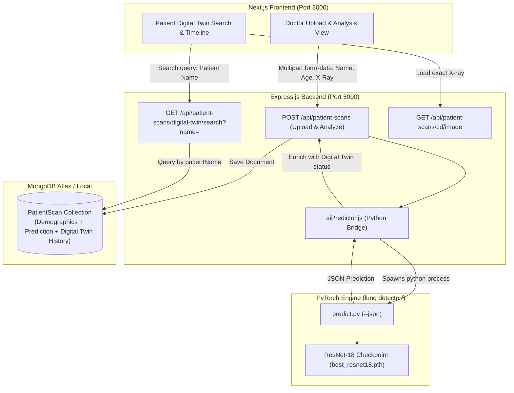

# 🫁 Implementation Plan: LungTwin AI Digital Twin Platform

## Goal Description
Build an end-to-end medical web application where:
1. **Doctor Portal**: A doctor can enter a patient's name and age, upload a chest X-ray image, and trigger real-time AI prediction using the trained ResNet-18 deep learning model (`lung detector/predict.py`).
2. **Digital Twin Generation & Storage**: The system automatically stores the prediction (Normal vs. Pneumonia, confidence, class probabilities), health status, and the exact X-ray image as a **Digital Twin** record under the patient's name in MongoDB.
3. **Patient Digital Twin Search & History**: Patients and doctors can search by patient name to view their complete Digital Twin timeline, tracking how their lung condition has evolved across past scans with interactive visual health indicators.
4. **Modern Next.js Frontend**: A modern, responsive web application with dedicated Doctor Upload and Patient Search views.

---

## Architecture Overview



---

## User Review Required

> [!IMPORTANT]
> **1. AI Model Bridge Execution**:
> The Express.js backend will call the trained PyTorch ResNet-18 model via a Node.js child process (`python3 predict.py --image <filePath> --json`).
> - This directly utilizes the Apple Silicon `mps` GPU acceleration already validated in `lung detector`.
> - Eliminates the need for a separate long-running Python HTTP microservice, keeping deployment lightweight and self-contained.

> [!IMPORTANT]
> **2. Digital Twin History Structure**:
> Whenever multiple scans are uploaded under the same patient name over time (e.g., initial diagnosis and 2-week follow-up), all scans are linked by `patientName` (case-insensitive indexed search).
> The search endpoint returns:
> - Patient summary (latest age, total scans, latest lung status).
> - Chronological progression timeline showing how the lung has changed from scan to scan.

> [!WARNING]
> **3. MongoDB Connection**:
> The backend currently has a placeholder in `.env` (`mongodb+srv://<username>:<password>...`). You will need to provide your MongoDB Atlas connection string (or run local MongoDB) so the database can persist records. We will also include mock fallback handling so the frontend and API can be demonstrated immediately even if MongoDB credentials are being configured.

---

## Open Questions

> [!NOTE]
> 1. **Patient Authentication**: Should the Patient Digital Twin search portal be open (searchable by patient name and optional age verification), or should patients have their own login credentials? (Recommendation: Open search by patient name for easy demo and access, with doctor-restricted upload actions).
> 2. **Digital Twin Visuals**: Would you like an animated 2D/3D glassmorphic lung schematic showing highlighted pulmonary zones alongside the actual chest X-ray image? (Included in our Next.js design plan).

---

## Proposed Changes

Grouped by component layer:

### Component 1: AI Predictor Bridge (`lung detector/`)

Add `--json` output support to `predict.py` so the backend can receive clean, structured JSON without parsing human-readable console text.

#### [MODIFY] `lung detector/predict.py`
- Add `--json` CLI argument to `argparse`.
- When `--json` is passed, output only the JSON-serialized prediction result to stdout.

---

### Component 2: Backend Architecture (`backend/`)

#### [MODIFY] `backend/models/PatientScan.js`
Extend schema to include structured `prediction` and `digitalTwin` sub-documents:
```javascript
prediction: {
  predictedClass: { type: String, enum: ['NORMAL', 'PNEUMONIA', 'PENDING'], default: 'PENDING' },
  confidence: { type: Number, default: 0 },
  confidencePercentage: { type: String, default: '0%' },
  probabilities: {
    normal: { type: Number, default: 0 },
    pneumonia: { type: Number, default: 0 }
  },
  isPneumonia: { type: Boolean, default: false },
  analyzedAt: { type: Date, default: null }
},
digitalTwin: {
  status: { type: String, enum: ['Healthy', 'Mild Risk', 'High Risk - Infection', 'Recovering'], default: 'Healthy' },
  severityIndex: { type: Number, default: 0 }, // 0 to 100
  conditionSummary: { type: String, default: '' },
  recommendedCare: [String],
  twinVersion: { type: Number, default: 1 }
}
```

#### [NEW] `backend/utils/aiPredictor.js`
Node.js utility to trigger Python inference asynchronously:
- Resolves the absolute path to `lung detector/predict.py`.
- Spawns `python3 predict.py --image <imagePath> --json`.
- Safely parses JSON output and enriches it with Digital Twin health classification (calculates severity index, condition summary, care recommendations).
- Handles timeouts and fallbacks gracefully.

#### [MODIFY] `backend/controllers/patientScanController.js`
- **`uploadPatientScan`**: Upon successful image upload and validation, automatically trigger `aiPredictor.runInference(imagePath)`.
- Persist the scan with full prediction and digital twin data in MongoDB.
- **`searchPatientDigitalTwin`** (New Controller):
  - Queries all scans for a given `patientName` sorted by `uploadedAt` descending.
  - Aggregates patient demographic summary, latest lung health state, and full chronological timeline of past scans.

#### [MODIFY] `backend/routes/patientScanRoutes.js`
- Expose `GET /api/patient-scans/digital-twin/search?patientName=...` (accessible for patient lookup).
- Expose `GET /api/patient-scans/digital-twin/patient/:patientName` for full digital twin history.

---

### Component 3: Next.js Frontend (`frontend/`)

Create a modern, responsive Next.js application inside `/Users/mackbook/Documents/lung/frontend/`.

#### [NEW] `frontend/` Structure
- `app/layout.jsx`: Root layout with custom fonts, dark/light theme provider, metadata.
- `app/page.jsx`: Landing dashboard introducing LungTwin AI, with quick actions to "Doctor Upload" and "Patient Digital Twin Search".
- `app/doctor/page.jsx`:
  - Patient Name & Age input form.
  - Drag-and-drop Chest X-Ray upload dropzone with instant image preview.
  - Real-time "Run AI Prediction & Generate Digital Twin" button.
  - Live analysis card showing model inference result, probability bars, and Digital Twin risk badge.
- `app/patient/page.jsx`:
  - Patient Name search bar with autocomplete / recent searches.
  - Interactive **Digital Twin Overview Card** (Lung health status, healthy vs compromised indicators).
  - **Chronological Timeline View**: Interactive cards for each scan in history showing dates, predictions, confidence, and doctor notes.
  - **High-Res X-Ray Viewer**: Side-by-side or modal inspection of the exact lung radiograph stored for that digital twin scan.
- `styles/globals.css`: Curated CSS styling with glassmorphism, medical slate & cyan palette, responsive layout, smooth micro-interactions.

---

## Verification Plan

### Automated Tests
1. **AI Bridge Test**:
   ```bash
   cd "/Users/mackbook/Documents/lung/backend"
   node -e "import('./utils/aiPredictor.js').then(m => m.runInference('../lung detector/dataset/chest_xray/test/PNEUMONIA/person1_virus_6.jpeg').then(console.log))"
   ```
2. **API Endpoint Test**:
   - Upload sample chest X-ray via `curl` with `patientName="John Doe"`, `age=45`.
   - Verify returned response contains `prediction` with `PNEUMONIA` or `NORMAL` and `digitalTwin` metadata.
3. **Search Endpoint Test**:
   - Query `GET /api/patient-scans/digital-twin/search?patientName=John` and verify chronological history of scans is returned.

### Manual Verification
1. Launch backend dev server on port 5000.
2. Launch Next.js frontend dev server on port 3000.
3. In browser:
   - Navigate to Doctor Upload page, fill in "Alice Smith", age 34, drop a chest X-ray, submit.
   - Verify the AI prediction displays immediately with probabilities and digital twin status.
   - Navigate to Patient Search page, search "Alice Smith".
   - Verify the digital twin shows her scan history, lung condition summary, and exact scan image.
